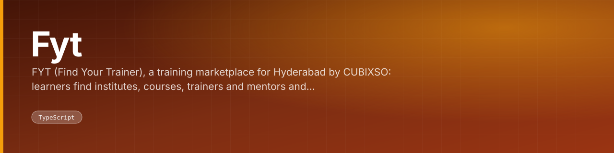
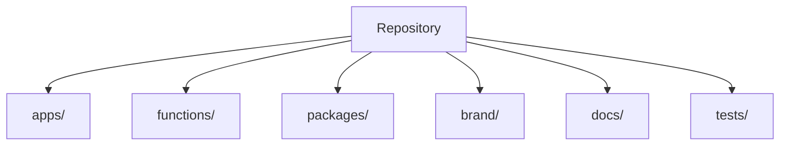

<div align="center">



FYT (Find Your Trainer), a training marketplace for Hyderabad by CUBIXSO: learners find institutes, courses, trainers and mentors and book demo sessions with auto-generated Google Meet links.

<br>


[](https://fyt-find-your-trainer-application.vercel.app)  

</div>

---

## What this is

FYT (Find Your Trainer), a training marketplace for Hyderabad by CUBIXSO: learners find institutes, courses, trainers and mentors and book demo sessions with auto-generated Google Meet links. This repo holds the admin console, brand kit and design docs. Built with Next.js 16, React 19, TypeScript and Tailwind CSS v4; Flutter app and Firebase next.

The code is laid out as:

- `docs/` — documentation
- `tests/` — tests

<div align="center">

|  |  |
|:--:|:--:|
| **21** | **17** |
| test files | docs |

</div>

---

## Architecture



<sub>Derived from the directories present in this repository.</sub>

---

## Surfaces

**Routes** (20)

|  |  |  |
|---|---|---|
| `/apps/admin/src/app` | `/apps/admin/src/app/[...missing]` | `/apps/admin/src/app/accept-invite` |
| `/apps/admin/src/app/analytics` | `/apps/admin/src/app/audit` | `/apps/admin/src/app/availability` |
| `/apps/admin/src/app/bookings` | `/apps/admin/src/app/broadcasts` | `/apps/admin/src/app/content` |
| `/apps/admin/src/app/courses` | `/apps/admin/src/app/credits` | `/apps/admin/src/app/institutes` |
| `/apps/admin/src/app/learners` | `/apps/admin/src/app/login` | `/apps/admin/src/app/login/verify` |
| `/apps/admin/src/app/ownership` | `/apps/admin/src/app/profile` | `/apps/admin/src/app/providers` |
| `/apps/admin/src/app/settings` | `/apps/admin/src/app/team` |  |

**API endpoints** (1)

|  |  |  |
|---|---|---|
| `/api/apps/admin/src/app/api/media/[...key]` |  |  |

---

## Getting started

```bash
git clone https://github.com/gowtham-creator/FYT---Find-your-trainer-Application.git
cd FYT---Find-your-trainer-Application
npm install
```

### Scripts

| Command | Runs |
|---|---|
| `npm run lint` | `npm run lint -w apps/admin -w apps/mobile` |
| `npm run typecheck` | `npm run typecheck -w packages/domain -w functions -w apps/mobile -w tests/rules` |
| `npm run test` | `npm test -w packages/domain -w apps/admin -w functions -w apps/mobile` |
| `npm run seed` | `npm run seed -w functions` |
| `npm run emulators` | `firebase emulators:start --project demo-fyt --import .emulator-data --export-on-exit` |
| `npm run emulators:fresh` | `firebase emulators:start --project demo-fyt` |
| `npm run build:functions` | `npm run build -w functions` |
| `npm run test:rules` | `firebase emulators:exec --project demo-fyt --only firestore,storage "npm test -w tests/rules"` |
| `npm run test:integration` | `firebase emulators:exec --project demo-fyt --only auth,firestore,functions "npm run test:integration -w functions"` |

Configuration comes from the environment. Copy the checked-in template and fill in your own values:

```bash
cp apps/mobile/.env.example .env.local
```

---

## Project structure

| Path | Contents | Files |
|---|---|---|
| `apps/` | — | 218 |
| `functions/` | — | 18 |
| `packages/` | — | 17 |
| `brand/` | — | 9 |
| `docs/` | documentation | 5 |
| `tests/` | tests | 5 |

<sub>286 tracked files in total.</sub>

---

<div align="center">
<sub><a href="https://github.com/gowtham-creator/FYT---Find-your-trainer-Application">gowtham-creator/FYT---Find-your-trainer-Application</a></sub>
</div>
