# FYT Firestore schema v1, indexes and security rules

Date: 2026-10-28 · Status: DRAFT for build · Session TRN-20260928-c20456ad
Companion to `docs/APP-ARCHITECTURE.md` (app, functions, environments, milestones).
Inputs: signed agreement §2 and §5, `docs/DESIGN-v2.md`, `docs/INTEGRATION-PLAN.md` §3–§4, and the admin's de facto model in `apps/admin/src/lib/data/types.ts`, `slots.ts`, `rbac.ts` and `storage/*`.
Precedence: contract > INTEGRATION-PLAN > this doc > DESIGN-v2. Where this doc settles one of the "divergences" in INTEGRATION-PLAN §4, it says so.

The schema serves three clients through one contract:
- **the mobile app** (React Native with Expo, React Native Firebase): client SDK; reads only, every write goes through a callable;
- **Cloud Functions**: Admin SDK; callables, triggers, workers;
- **the Next.js admin**: Admin SDK in server actions, through `packages/domain`.

`packages/domain` (`@fyt/domain`, zod v4) is the single source of truth for the shapes below. The TypeScript blocks in this doc are the specification it must implement. The app, the admin and Functions import the same schemas and types, so there is no second model layer to keep in sync.

---

## 1. Conventions

| Rule | Detail |
|---|---|
| Field names | camelCase. No spaces, no dots. |
| Times | **Epoch milliseconds as `int`** for every domain time (`start`, `end`, `createdAt` …). This matches the admin types and `slots.ts`. There are exactly two exceptions, and both are Firestore `Timestamp`: TTL fields (`expireAt`, `holdExpiresAt`) and the one client-written field (`notifications.readAt`, which must equal `request.time` in the rules). |
| Calendar dates | `"YYYY-MM-DD"`, always an **Asia/Kolkata** calendar day. Minutes are counted from IST midnight (`startMinute`). IST is UTC+05:30 with no DST. The conversion is `slots.ts` `istEpoch()`. |
| Versioning | Every top-level document has `schemaVersion: 1`. Changes within a version are additive only. Readers ignore unknown fields. **Unknown enum values decode to `unknown`**, and the app renders them safely. The full breaking-change procedure is INTEGRATION-PLAN §4. |
| Who writes | Clients never write domain data. The app writes only `users/{uid}/notifications/{id}.readAt`. Everything else is written by Functions or by admin server actions, both through the Admin SDK. |
| Audit fields | Admin-written catalog docs carry `createdBy`, `updatedBy` (operator uid) and `createdAt`, `updatedAt`. |
| Money | None in Phase 1. Payments are Phase 2, so there are no price, fee or currency fields. |
| Ratings / reviews | Admin-entered display values only (contract §2.5, §2.6; DESIGN-v2 §1). There is no user-submitted review collection in Phase 1. |
| Strings | Trimmed server-side. Length limits are enforced in zod and repeated in the app's form validation. |
| PII | Phone and email for learners live only in `users/{uid}`, plus booking snapshots that only the owner and operators can read. Provider and course **host emails are private**, in a `private/contact` subdocument that no client can read. |

### 1.1 Document IDs

| Kind | Format | Example | Notes |
|---|---|---|---|
| Learner / user | Firebase Auth uid | `Yc3k…Q2` (28 chars) | `users/{uid}`. The admin's `Learner.id` becomes the uid. |
| Operator | Firebase Auth uid | | `admins/{uid}`. Replaces `adm_*` demo ids. |
| Institute / course / provider | `ins_` / `crs_` / `prv_` + 20 chars `[a-z0-9]` | `crs_k3v9q0d2m7x1p5r8t4wz` | Must satisfy the admin image-key regex `^[a-z]{2,5}_[a-z0-9]{1,32}$` (`storage/image-validation.ts`), because image paths embed the owner id. |
| Booking | `bkg_` + first 26 chars of base32 (lowercase, no padding) of `sha256(uid + ":" + clientRequestId)` | `bkg_m4x…` | Deterministic, which makes `createBookingV1` idempotent (§5). |
| Booking ref (human) | `BK-` + 6 chars from `ABCDEFGHJKLMNPQRSTUVWXYZ23456789` | `BK-7KQ2MX` | Reserved in `bookingRefs/{ref}` inside the booking transaction. The admin seed's 4-char refs (`BK-4F2K`) stay valid: the display/parse regex is `^BK-[A-HJ-NP-Z2-9]{4,8}$`. |
| Availability | the listing's id | `availability/prv_…` | One doc per bookable listing. |
| Slot ledger | `{targetId}_{yyyymmdd}` | `prv_…_20261112` | One doc per listing per IST day. |
| Slot (virtual) | `{targetId}~{YYYY-MM-DD}~{startMinute}~{mode}` | `crs_…~2026-11-12~600~online` | Not a document. It is generated by `getAvailabilityV1` and parsed and re-validated by `createBookingV1`. |
| Rule / exception | `avr_` / `avx_` + 12 chars | | Array items inside `availability/{id}`. |
| Broadcast / announcement | `bc_` + 16 chars | | An announcement reuses its broadcast's id. |
| Notification | `ntf_` + 16 chars | | |
| Audit entry | `aud_` + 20 chars | | |
| Device | hex `sha256(fcmToken)` | | `users/{uid}/devices/{hash}` |

`packages/domain/src/ids.ts` owns `newId(prefix)`, `bookingIdFor(uid, clientRequestId)`, `calendarEventIdFor(bookingId)` and `refCandidates(n)`. All of them use `crypto.randomBytes` or `crypto.createHash`.

---

## 2. Collection map

| Path | Written by | App reads | Admin reads | Purpose |
|---|---|---|---|---|
| `users/{uid}` | `ensureUserV1`, `saveProfileV1`, `deleteAccountV1`, admin (block) | own doc | all | Account plus learner profile (student or corporate) |
| `users/{uid}/devices/{hash}` | `registerDeviceV1`, `unregisterDeviceV1`, FCM pruning | none | none | FCM tokens |
| `users/{uid}/notifications/{id}` | Functions; app sets `readAt` | own | none | In-app inbox (90-day TTL) |
| `admins/{uid}` | admin (team, ownership) | none | yes | Operators: role, permissions, status |
| `institutes/{id}` | admin | published only | all | Institute directory (§2.3) |
| `courses/{id}` | admin | published only | all | Courses and projects (§2.2) |
| `courses/{id}/private/contact` | admin | none | yes | Demo host email for online course demos |
| `providers/{id}` | admin | published only | all | Trainers, mentors, consultants (§2.4–2.6) |
| `providers/{id}/private/contact` | admin | none | yes | Provider email/phone (calendar invite recipient) |
| `catalogIndex/{kind}` | trigger | yes | yes | One summary doc per kind (`courses`, `institutes`, `providers`), used for browse, filter and search |
| `availability/{targetId}` | admin | none | yes | Weekly rules plus date exceptions |
| `slotLedgers/{targetId}_{yyyymmdd}` | booking transactions only | none | yes | Seats held per listing per day |
| `bookings/{id}` | `createBookingV1`, `cancelBookingV1`, `rescheduleBookingV1`, admin domain ops, workers | own (`userId == uid`) | all | Bookings |
| `bookingRefs/{ref}` | booking transaction | none | yes | Uniqueness reservation for human refs |
| `broadcasts/{id}` | admin; worker sets status | none | yes | Push broadcasts (§2.8 platform updates) |
| `announcements/{id}` | `broadcastWorker` | yes | yes | Public, sanitised copy of a sent broadcast, used for the inbox |
| `config/public` | admin (settings, content) | **yes, even signed out** | yes | Gates, taxonomy, featured lists, booking policy |
| `config/private` | admin, deploy scripts | none | yes | Meet provider, organiser calendar, alert emails |
| `statsDaily/{yyyy-mm-dd}` | triggers, nightly reconcile | none | yes | Analytics counters (replaces DESIGN-v2's invalid `stats/daily/{date}`) |
| `audit/{id}` | admin (same transaction as the change), Functions (`system`) | none | superadmin+ | Audit log |
| `deadLetters/{id}` | workers | none | yes | Final failures (Meet, broadcast) that need a human |

---

## 3. Documents

### 3.1 `users/{uid}`: account plus learner profile

Admin source: `Learner`. Contract source: §2.1 onboarding fields.

```ts
interface UserDoc {
  schemaVersion: 1;
  role: "learner";                    // reserved: "provider" if a trainer login is ever added (CR)
  phone: string;                      // E.164 "+91XXXXXXXXXX", copied from the Auth token by ensureUserV1; never client-supplied
  name: string;                       // 2–80
  email?: string;                     // optional; lowercased; enables calendar invites (see open question Q4)
  segment: "student" | "corporate" | null;   // null until onboarding step 1
  area?: string;                      // one of config/public.taxonomy.areas (Ameerpet, Madhapur, …)
  // student (contract: educational institution, course interests, desired tech skills)
  institution?: string;               // admin: institution
  // corporate (contract: current role, years of experience, tech stack to learn)
  company?: string;                   // admin: company
  currentRole?: string;               // admin: currentRole
  yearsExperience?: number;           // admin: yearsExperience; int 0–50
  interests: string[];                // admin: interests. Course interests = taxonomy.categories. ≤10
  skillsToLearn: string[];            // NEW. Desired tech skills / stack to learn = taxonomy.techStacks. ≤15
  // profile setup (contract: educational background, work experience)
  education: Array<{ institution: string; degree: string; field?: string; startYear?: number; endYear?: number }>;      // ≤10
  experience: Array<{ company: string; title: string; startYear?: number; endYear?: number; current?: boolean }>;        // ≤10
  onboarded: boolean;                 // admin: onboarded. true once the segment form is saved
  onboardingStep: "segment" | "details" | "profile" | "done";
  blocked: boolean;                   // admin: blocked. Mirrored to Auth `disabled`
  blockedReason?: string;
  createdAt: number;                  // admin: createdAt (registration time = first ensureUserV1)
  updatedAt: number;
  lastActiveAt: number;               // admin: lastActiveAt. ensureUserV1 bumps it, at most once per 6 h
  deletedAt?: number;                 // set by deleteAccountV1 (the doc is anonymised, not removed, so bookings keep a referent)
}
```

Subcollections:

```ts
// users/{uid}/devices/{sha256(token)}
interface DeviceDoc { token: string; platform: "android" | "ios"; appVersion: string; locale?: string; createdAt: number; lastSeenAt: number }

// users/{uid}/notifications/{ntf_id}
interface NotificationDoc {
  type: "booking_confirmed" | "booking_cancelled" | "booking_rescheduled" | "booking_meet_delayed" | "reminder" | "announcement";
  title: string; body: string;
  bookingId?: string; announcementId?: string;
  createdAt: number;
  readAt?: Timestamp;                 // the only client-written field; must equal request.time
  expireAt: Timestamp;                // TTL, createdAt + 90 days
}
```

### 3.2 `admins/{uid}`: operators

Admin source: `Admin` and `rbac.ts`. Operators are Firebase Auth **email** accounts. They never have the phone provider linked (see APP-ARCHITECTURE §4.4).

```ts
interface AdminDoc {
  schemaVersion: 1;
  name: string; email: string;
  phone?: string;                     // contact / console second-factor delivery only; NOT an Auth credential
  role: "owner" | "superadmin" | "admin";
  permissions: Permission[];          // rbac.ts PERMISSION_KEYS; only meaningful for role "admin"
  status: "active" | "invited" | "disabled";
  tokenVersion: number;               // bumped on disable, role change or "sign out everywhere"
  createdAt: number; lastLoginAt?: number; invitedBy?: string;
  // dropped from the admin type: passwordHash (Firebase Auth owns credentials)
}
```

Custom claim mirrored on every role change: `{ fytRole: "owner" | "superadmin" | "admin" }`. Permissions are never put in claims, because claims are capped at 1000 bytes and go stale until the token refreshes.

### 3.3 Catalog

```ts
// Shared. Admin source: ImageRef (storage/types.ts, types.ts)
interface ImageRef {
  key: string;            // catalog/{providers|courses|institutes}/{ownerId}/{32 hex}.{jpg|png|webp}
  url: string;            // Firebase Storage download-token URL (capability URL, cacheable)
  thumbUrl?: string;      // 480 px webp variant, added later if thumbnails are enabled (APP-ARCHITECTURE §7)
  contentType: "image/jpeg" | "image/png" | "image/webp";
  bytes: number; width: number; height: number;
  uploadedAt: number; uploadedBy: string;
}

interface Venue { address: string; area: string; mapsUrl?: string; geo?: { lat: number; lng: number } }
```

```ts
// institutes/{ins_id}. Admin source: Institute. Contract §2.3
interface InstituteDoc {
  schemaVersion: 1;
  name: string; area: string; address: string;
  geo?: { lat: number; lng: number }; mapsUrl?: string;       // NEW, optional: "Open in Maps"
  phone: string; email: string; website?: string;              // public contact details (the contract shows contact)
  about?: string;                                              // NEW, optional, ≤2000
  categories: string[]; specializations: string[];
  gallery: ImageRef[];                                         // ordered; [0] is the cover. ≤12
  published: boolean; featured: boolean;
  createdAt: number; updatedAt: number; createdBy: string; updatedBy: string;
}
```

```ts
// courses/{crs_id}. Admin source: Course. Contract §2.2
interface CourseDoc {
  schemaVersion: 1;
  kind: "course" | "project";
  title: string;
  instituteId?: string;
  instituteName?: string;            // DENORM, kept in sync by onInstituteWritten
  category: string; techStack: string[];
  durationWeeks: number;
  modes: Array<"online" | "offline">;
  description: string;               // ≤5000
  highlights?: string[];             // NEW, optional, ≤8 bullet points
  cover?: ImageRef;
  demoMinutes: number;               // NEW, display only. The real slot length comes from availability rules. Default 60
  venue?: Venue;                     // NEW. Offline demo address; defaults to the institute's address
  published: boolean; featured: boolean;
  createdAt: number; updatedAt: number; createdBy: string; updatedBy: string;
}
// courses/{id}/private/contact
interface CourseContact { hostEmail?: string }   // falls back to the institute email (open question Q9)
```

```ts
// providers/{prv_id}. Admin source: Provider. Contract §2.4 (consultants), §2.5 (trainers), §2.6 (mentors)
interface ProviderDoc {
  schemaVersion: 1;
  type: "trainer" | "mentor" | "consultant";
  name: string;
  isOrganisation: boolean;           // trainers listed as organisations in the institute directory (§2.3)
  headline: string;
  bio?: string;                      // NEW (INTEGRATION-PLAN §1 gap): background, ≤3000
  expertise: string[];               // skills / tech
  domain?: string;                   // NEW: mentors are browsed by domain (§2.6)
  specializations?: string[];        // NEW: consultants, e.g. "Job consultation", "Higher education" (§2.4)
  yearsExperience: number;
  currentTitle?: string; organisation?: string;   // NEW, optional (e.g. "VP Engineering, …")
  rating?: number;                   // admin-entered display value 0–5, one decimal (Phase 1)
  reviewSnippets?: Array<{ quote: string; author: string; context?: string }>;  // NEW: admin-entered, ≤5 (§2.6 "reviews")
  session: { minutes: number; modes: Array<"online" | "offline">; about?: string };   // NEW: "session information"
  venue?: Venue;                     // NEW: needed only if offline sessions are offered
  photo?: ImageRef;
  published: boolean; featured: boolean;
  createdAt: number; updatedAt: number; createdBy: string; updatedBy: string;
  // MOVED: admin Provider.email -> providers/{id}/private/contact (published provider docs are readable by every learner)
}
// providers/{id}/private/contact
interface ProviderContact { email: string; phone?: string }
```

There are no "pricing" or "verification queue" fields. Trainers do not self-register in Phase 1, because every listing is created by the admin (§2.7). "Approval" is the admin setting `published: true`.

### 3.4 `catalogIndex/{courses|institutes|providers}`

This is a single summary document per kind, maintained by the catalog triggers. The app reads one document to browse, filter and search a whole kind, and that document is also cached for offline use. Filters that combine two arrays (for example categories plus specializations) are impossible as Firestore queries, so filtering happens on the client.

```ts
interface CatalogIndexDoc<T> { schemaVersion: 1; kind: "courses" | "institutes" | "providers"; builtAt: number; count: number; items: T[] }

type CourseItem = { id: string; kind: "course" | "project"; title: string; instituteId?: string; instituteName?: string;
  category: string; techStack: string[]; durationWeeks: number; modes: ("online" | "offline")[]; featured: boolean;
  coverUrl?: string; area?: string; q: string; updatedAt: number };
type InstituteItem = { id: string; name: string; area: string; categories: string[]; specializations: string[];
  featured: boolean; coverUrl?: string; q: string; updatedAt: number };
type ProviderItem = { id: string; type: "trainer" | "mentor" | "consultant"; name: string; isOrganisation: boolean;
  headline: string; expertise: string[]; domain?: string; specializations?: string[]; yearsExperience: number;
  rating?: number; featured: boolean; photoUrl?: string; modes: ("online" | "offline")[]; q: string; updatedAt: number };
// q = lowercased, de-accented "name/title + headline + category + tags + area": a substring-search haystack
```

- **Only published docs** are included.
- **Updates.** Each catalog write does an incremental replace or remove of the one item, in a transaction (1 read + 1 write). The weekly `maintenanceJobs` does a full rebuild.
- **Size guard.** If the serialised `items` would exceed 800 KB (about 2,000 courses), the trigger switches to shards `catalogIndex/{kind}_0..n` and records `shards: n` on `catalogIndex/{kind}`. The app supports both shapes from v1.

### 3.5 Availability and ledgers

Admin source: `AvailabilityRule`, `AvailabilityException` and `slots.ts`. This settles the INTEGRATION-PLAN divergence: **one doc per target**, not the flat collection or subcollections.

```ts
// availability/{targetId}
interface AvailabilityDoc {
  schemaVersion: 1;
  targetType: "course" | "trainer" | "mentor" | "consultant";
  targetId: string;
  timezone: "Asia/Kolkata";
  rules: Array<{ id: string; weekday: 0|1|2|3|4|5|6; startMinute: number; endMinute: number;
                 slotMinutes: number; mode: "online" | "offline"; capacity: number }>;   // 06:00 ≤ start < end ≤ 23:59
  exceptions: Array<{ id: string; date: string; kind: "blocked" | "extra"; startMinute?: number; endMinute?: number;
                      slotMinutes?: number; mode?: "online" | "offline"; capacity?: number; reason?: string;
                      createdBy: string; createdAt: number }>;   // pruned 90 days after `date`
  updatedAt: number; updatedBy: string;
}
```

Slots are **generated on read**, never materialised. They come from `generateSlots()` / `planDays()`, moved unchanged from `apps/admin/src/lib/slots.ts` to `packages/domain/src/slots.ts`. The admin re-exports that module, and its existing tests move with it.

```ts
// slotLedgers/{targetId}_{yyyymmdd}: written ONLY inside booking transactions
interface SlotLedgerDoc {
  targetId: string; targetType: string; date: string;
  entries: Record<string /* bookingId */, { start: number; end: number; mode: "online" | "offline"; uid: string }>;
  updatedAt: number;
}
```

- `entries` holds every booking that occupies a seat: `requested`, `confirmed`, `meet_failed`, `completed` and `no_show`.
- Cancelling removes the entry **in the same transaction**.
- Rules are held to 06:00–23:59 IST, so a slot never crosses midnight and one day's ledger is enough.
- Seat rule, the same as `slots.ts` rule 6: `remaining = capacity − |entries overlapping [start, end)|`.

### 3.6 `bookings/{bkg_id}`

Admin source: `Booking`, plus the `BookingRow` join fields, which are now denormalised.

```ts
type BookingStatus = "requested" | "confirmed" | "completed" | "cancelled" | "no_show" | "meet_failed";

interface BookingDoc {
  schemaVersion: 1;
  ref: string;                          // admin: ref
  userId: string;                       // admin: learnerId (renamed)
  // snapshot of the learner at booking time (admin BookingRow: learnerName/Phone/Segment)
  userName: string; userPhone: string; userEmail?: string; userSegment: "student" | "corporate";
  targetType: "course" | "trainer" | "mentor" | "consultant";
  targetId: string;
  targetName: string; targetPhotoUrl?: string;      // DENORM snapshot (admin targetName())
  instituteId?: string; instituteName?: string;     // course bookings
  slotId: string;
  date: string; startMinute: number;                // IST
  start: number; end: number;                       // epoch ms
  mode: "online" | "offline";
  status: BookingStatus;
  meet?: {                                          // online only. Replaces admin meetLink
    status: "pending" | "ok" | "failed";
    op: "create" | "patch" | "delete";              // what the worker must do next
    link?: string;                                  // admin: meetLink
    eventId?: string;                               // deterministic, from the booking id
    attempts: number; lastError?: string; updatedAt: number;
  };
  offlineAddress?: string; offlineMapsUrl?: string; // admin: offlineAddress
  note?: string;                                    // admin: note. Learner's note, ≤500
  clientRequestId: string;                          // idempotency key (uuid v4 from the app)
  cancelledReason?: string;                         // admin: cancelledReason
  cancelledBy?: "user" | "admin" | "system"; cancelledAt?: number;
  rescheduleCount: number; rescheduledFrom?: { start: number; end: number }; lastOpId?: string;
  reminders: Record<string /* minutes, e.g. "60" */, number /* sentAt */>;
  holdExpiresAt?: Timestamp;                        // set while status == requested; the sweeper acts on it
  history: Array<{ at: number; by: "user" | "admin" | "system"; actorId?: string;
                   action: "created" | "confirmed" | "meet_failed" | "meet_retry" | "rescheduled" | "cancelled" | "completed" | "no_show";
                   from?: BookingStatus; to?: BookingStatus; note?: string }>;   // capped at 30
  createdAt: number; updatedAt: number; confirmedAt?: number;
}

// bookingRefs/{ref}
interface BookingRefDoc { bookingId: string; createdAt: number }
```

#### Status machine

```mermaid
stateDiagram-v2
  [*] --> requested: createBooking (online)
  [*] --> confirmed: createBooking (offline, auto-confirm; Q5)
  requested --> confirmed: meetWorker ok
  requested --> meet_failed: meetWorker final failure / sweeper
  meet_failed --> confirmed: admin retry ok, or admin pastes a link
  requested --> cancelled: user / admin / system
  confirmed --> cancelled: user (before the window) / admin / system
  meet_failed --> cancelled: admin / system (auto at T-2h; Q8)
  confirmed --> completed: admin markOutcome (after end)
  confirmed --> no_show: admin markOutcome (after end)
  completed --> [*]
  no_show --> [*]
  cancelled --> [*]
```



| Transition | Who | Side effects (always run by the `onBookingWritten` trigger, so the app and admin behave identically) |
|---|---|---|
| create → requested | `createBookingV1` | ledger entry + ref (same transaction); trigger enqueues `meetWorker{op:create}` |
| create → confirmed (offline) | `createBookingV1` | ledger + ref; trigger sends push + inbox, bumps stats |
| requested → confirmed | `meetWorker` | push "Booking confirmed" with link, inbox, stats `meetOk` |
| requested → meet_failed | `meetWorker` (final attempt) or `bookingsSweep` | `deadLetters` doc, alert metric, admin attention queue, learner push "Your link is delayed" |
| meet_failed → confirmed | admin `retryMeetLink` (sets `meet.status=pending`) → worker; or admin sets a manual link | push with link |
| reschedule (status unchanged) | admin; app only if Q6 allows | ledger move (same transaction); trigger enqueues `meetWorker{op:patch}`; push |
| → cancelled | `cancelBookingV1` / admin / sweeper | ledger entry removed (same transaction); trigger enqueues `meetWorker{op:delete}`; push unless the user cancelled it themselves |
| confirmed → completed / no_show | admin `markOutcome` (only after `end`) | stats |

`packages/domain/src/booking.ts` exports the allowed-transition table. Every writer goes through `assertTransition(from, to, actor)`.

### 3.7 Notifications, broadcasts, config

```ts
// broadcasts/{bc_id}. Admin source: Broadcast
interface BroadcastDoc {
  schemaVersion: 1;
  title: string; body: string;                    // ≤65 / ≤240 for push display
  audience: "all" | "student" | "corporate";
  status: "draft" | "scheduled" | "queued" | "sending" | "sent" | "failed" | "withdrawn";   // admin's draft|scheduled|sent, extended
  scheduledFor?: number; sentAt?: number;
  audienceSize?: number;                          // RENAMED from admin `reach`: users in the segment at send time (honest label)
  fcmMessageIds?: string[]; lastError?: string;
  createdBy: string; createdAt: number; updatedAt: number;
}

// announcements/{bc_id}: written by broadcastWorker on send
interface AnnouncementDoc { schemaVersion: 1; title: string; body: string; audience: "all" | "student" | "corporate"; sentAt: number }
```

```ts
// config/public: readable by anyone, including signed-out apps (needed for the update and maintenance gates)
interface ConfigPublic {
  schemaVersion: 1;
  platformName: string;                                   // admin PlatformSettings.platformName
  supportEmail: string; supportPhone?: string;            // admin supportEmail
  maintenance: { on: boolean; message?: string; until?: number };   // admin maintenanceMode
  minAppVersion: { android: string; ios: string };        // semver; below this the app shows the update gate
  booking: {
    leadHours: number;                  // admin bookingLeadHours (default 4)
    cancellationWindowHours: number;    // admin cancellationWindowHours (default 2)
    horizonDays: number;                // NEW, default 14
    maxActiveBookings: number;          // NEW, default 5 (Q7)
    userReschedule: boolean;            // NEW, default false (Q6)
    requireEmailForOnline: boolean;     // NEW, default false (Q4)
  };
  reminderMinutes: number[];            // admin reminderMinutes, default [60, 15]
  taxonomy: { categories: string[]; techStacks: string[]; areas: string[]; mentorDomains: string[]; consultantSpecializations: string[] };
  featured: { institutes: string[]; courses: string[]; providers: string[] };   // admin homeFeatured
  legal: { privacyUrl: string; termsUrl: string; deleteAccountUrl: string };
  updatedAt: number; updatedBy: string;
}

// config/private: admin and Functions only
interface ConfigPrivate {
  schemaVersion: 1;
  meetProvider: "google_workspace" | "oauth_account";     // admin settings.meetProvider; read-only in the UI (deploy-time choice)
  organizerEmail: string;                                 // the calendar that owns events
  calendarId: string;                                     // usually "primary" of the organiser
  alertEmails: string[];
}
```

### 3.8 Analytics, audit, dead letters

```ts
// statsDaily/{yyyy-mm-dd} (IST day): FieldValue.increment from triggers; nightly reconcile recomputes the last 3 days
interface StatsDaily {
  date: string;
  registrations: { student: number; corporate: number; unsegmented: number };
  onboarded: number;
  bookingAttempts: number;                 // createBookingV1 calls (contract §10 completion-rate denominator)
  bookingsCreated: { course: number; trainer: number; mentor: number; consultant: number };
  confirmed: number; cancelled: number; completed: number; noShow: number;
  meetOk: number; meetFailed: number;
  updatedAt: number;
}

// audit/{aud_id}. Admin source: AuditEntry
interface AuditDoc {
  id: string; at: number;
  actorId: string; actorName: string;
  actorRole: "owner" | "superadmin" | "admin" | "system";   // "system" added for Functions
  action: string;                          // e.g. "booking.cancel", "meet.failed"
  target?: string;                         // human label
  targetRef?: { collection: string; id: string };   // NEW: machine link
  detail?: string;
  severity: "info" | "notice" | "critical";
  requestId?: string;
}

// deadLetters/{id}
interface DeadLetter { kind: "meet" | "broadcast"; refId: string; error: string; attempts: number; createdAt: number; resolvedAt?: number; expireAt: Timestamp /* +180 d */ }
```

---

## 4. Denormalisation

| Copy | Source of truth | Kept in sync by | Staleness tolerated |
|---|---|---|---|
| `courses.instituteName` | `institutes.name` | `onInstituteWritten` updates that institute's courses (batched) | seconds |
| `catalogIndex/*` items | catalog docs | `onCourseWritten` / `onInstituteWritten` / `onProviderWritten`, plus the weekly rebuild | seconds |
| `bookings.userName/Phone/Email/Segment` | `users/{uid}` | **Snapshot, never updated.** The admin shows what the learner booked with | n/a |
| `bookings.targetName/PhotoUrl/instituteName` | catalog | Snapshot. A renamed listing does not rewrite history | n/a |
| `bookings.offlineAddress` | `venue`, or the institute address | Snapshot. An admin address change after booking must reschedule or notify by hand | n/a |
| `slotLedgers.entries` | `bookings` | Same transaction as every booking write; nightly reconcile asserts equality and alerts on drift | none |
| `broadcasts.audienceSize` | `users` count by segment | `count()` aggregation at send time | n/a |
| `statsDaily` | users and bookings | increments plus nightly reconcile | 1 day |

---

## 5. Booking write paths (summary; full design in APP-ARCHITECTURE §5)

`createBookingV1` is one Firestore transaction. All reads come before any writes.
1. **Read:**
   - `bookings/{bookingIdFor(uid, clientRequestId)}`. If it exists with the same `slotId`, return it with `replayed: true`. If the `slotId` differs, fail with `IDEMPOTENCY_MISMATCH`.
   - `config/public`, `users/{uid}`, the target doc (must be `published`), `availability/{targetId}` and `slotLedgers/{targetId}_{yyyymmdd}`.
   - The user's live bookings: `where userId == uid, status in [requested, confirmed, meet_failed], start < newEnd`. This uses index B3.
   - `bookingRefs/{c}` for 3 random ref candidates.
2. **Check:** run `planDays()` for that date with the ledger entries as bookings. The slot must exist with `state == "open"` for the requested `mode`.
   - Missing slot: `SLOT_NOT_OFFERED`. No seats: `SLOT_FULL`. Inside the lead time: `LEAD_TIME`.
   - The user already has an overlapping live booking: `USER_OVERLAP`. Too many live bookings: `BOOKING_LIMIT`.
3. **Write:** `bookings/{id}`, `bookingRefs/{ref}` (the first free candidate) and the ledger entry.

Cancel and reschedule run the same kind of transaction over the booking and the affected ledger(s).

---

## 6. Indexes: `firestore.indexes.json`

```json
{
  "indexes": [
    { "collectionGroup": "bookings", "queryScope": "COLLECTION", "fields": [
      { "fieldPath": "userId", "order": "ASCENDING" }, { "fieldPath": "start", "order": "ASCENDING" } ] },
    { "collectionGroup": "bookings", "queryScope": "COLLECTION", "fields": [
      { "fieldPath": "userId", "order": "ASCENDING" }, { "fieldPath": "start", "order": "DESCENDING" } ] },
    { "collectionGroup": "bookings", "queryScope": "COLLECTION", "fields": [
      { "fieldPath": "userId", "order": "ASCENDING" }, { "fieldPath": "status", "order": "ASCENDING" }, { "fieldPath": "start", "order": "ASCENDING" } ] },
    { "collectionGroup": "bookings", "queryScope": "COLLECTION", "fields": [
      { "fieldPath": "status", "order": "ASCENDING" }, { "fieldPath": "start", "order": "ASCENDING" } ] },
    { "collectionGroup": "bookings", "queryScope": "COLLECTION", "fields": [
      { "fieldPath": "targetId", "order": "ASCENDING" }, { "fieldPath": "start", "order": "ASCENDING" } ] },
    { "collectionGroup": "bookings", "queryScope": "COLLECTION", "fields": [
      { "fieldPath": "targetId", "order": "ASCENDING" }, { "fieldPath": "status", "order": "ASCENDING" }, { "fieldPath": "start", "order": "ASCENDING" } ] },
    { "collectionGroup": "users", "queryScope": "COLLECTION", "fields": [
      { "fieldPath": "segment", "order": "ASCENDING" }, { "fieldPath": "createdAt", "order": "DESCENDING" } ] },
    { "collectionGroup": "broadcasts", "queryScope": "COLLECTION", "fields": [
      { "fieldPath": "status", "order": "ASCENDING" }, { "fieldPath": "scheduledFor", "order": "ASCENDING" } ] },
    { "collectionGroup": "announcements", "queryScope": "COLLECTION", "fields": [
      { "fieldPath": "audience", "order": "ASCENDING" }, { "fieldPath": "sentAt", "order": "DESCENDING" } ] },
    { "collectionGroup": "audit", "queryScope": "COLLECTION", "fields": [
      { "fieldPath": "actorId", "order": "ASCENDING" }, { "fieldPath": "at", "order": "DESCENDING" } ] },
    { "collectionGroup": "audit", "queryScope": "COLLECTION", "fields": [
      { "fieldPath": "severity", "order": "ASCENDING" }, { "fieldPath": "at", "order": "DESCENDING" } ] }
  ],
  "fieldOverrides": [
    { "collectionGroup": "catalogIndex", "fieldPath": "items", "indexes": [] },
    { "collectionGroup": "slotLedgers", "fieldPath": "entries", "indexes": [] },
    { "collectionGroup": "availability", "fieldPath": "rules", "indexes": [] },
    { "collectionGroup": "availability", "fieldPath": "exceptions", "indexes": [] },
    { "collectionGroup": "bookings", "fieldPath": "history", "indexes": [] },
    { "collectionGroup": "institutes", "fieldPath": "gallery", "indexes": [] },
    { "collectionGroup": "courses", "fieldPath": "description", "indexes": [] },
    { "collectionGroup": "providers", "fieldPath": "bio", "indexes": [] },
    { "collectionGroup": "providers", "fieldPath": "reviewSnippets", "indexes": [] },
    { "collectionGroup": "users", "fieldPath": "education", "indexes": [] },
    { "collectionGroup": "users", "fieldPath": "experience", "indexes": [] },
    { "collectionGroup": "notifications", "fieldPath": "expireAt", "ttl": true, "indexes": [] },
    { "collectionGroup": "deadLetters", "fieldPath": "expireAt", "ttl": true, "indexes": [] }
  ]
}
```

| Index | Serves |
|---|---|
| B1/B2 (`userId, start ±`) | App "My bookings" upcoming (asc, `start >= now`) and past (desc) |
| B3 (`userId, status, start`) | Overlap and limit check inside `createBookingV1` / reschedule |
| B4 (`status, start`) | `remindersTick`, `bookingsSweep`, admin attention queue |
| B5/B6 (`targetId, …`) | Admin per-listing calendar; "can't delete while upcoming bookings exist" guard |
| users | Admin learners list by segment |
| broadcasts | Scheduled-broadcast dispatch, admin list |
| announcements | App inbox: `audience in ["all", segment]` ordered by `sentAt` |
| audit | Admin audit filters |

Field overrides switch off single-field indexing on large arrays and maps. Every element of `catalogIndex.items` would otherwise be indexed, which costs writes and runs into the per-doc index-entry limit. TTL is enabled on `expireAt`. If the CLI version in use rejects `"ttl": true`, apply it with `gcloud firestore fields ttls update expireAt --collection-group=notifications --enable-ttl`. Catalog list screens need **no** composite indexes, because they read `catalogIndex`. Detail reads are by id.

---

## 7. Security rules

Principle (INTEGRATION-PLAN S1): **clients write nothing except `notifications.readAt`.**
- The Admin SDK (Functions and admin server actions) bypasses rules, so the rules only describe what the app may read.
- Anything not matched is denied.
- `isLearner()` requires the phone provider. Operator email accounts and future providers therefore get no catalog or booking access through the client SDK, which the console does not need anyway.

### 7.1 `firestore.rules`

```
rules_version = '2';
service cloud.firestore {
  match /databases/{database}/documents {

    function signedIn()  { return request.auth != null; }
    function isLearner() { return signedIn() && request.auth.token.firebase.sign_in_provider == 'phone'; }
    function isSelf(uid) { return signedIn() && request.auth.uid == uid; }
    function isPublished() { return resource.data.published == true; }

    // App config. Readable before sign-in so the update/maintenance gates work on the welcome screen.
    match /config/{docId} {
      allow get: if docId == 'public';
    }

    // Catalog: published docs only. Queries MUST include where('published', '==', true).
    // Subcollections (courses/{id}/private/*, providers/{id}/private/*) are not matched, so they are denied.
    match /institutes/{id}   { allow get, list: if isLearner() && isPublished(); }
    match /courses/{id}      { allow get, list: if isLearner() && isPublished(); }
    match /providers/{id}    { allow get, list: if isLearner() && isPublished(); }
    match /catalogIndex/{id} { allow get: if isLearner(); }
    match /announcements/{id} { allow get, list: if isLearner(); }

    // Own account. All writes go through callables (ensureUserV1, saveProfileV1, deleteAccountV1).
    match /users/{uid} {
      allow get: if isSelf(uid);

      match /notifications/{nid} {
        allow get, list: if isSelf(uid);
        allow update: if isSelf(uid)
          && request.resource.data.diff(resource.data).affectedKeys().hasOnly(['readAt'])
          && request.resource.data.readAt == request.time;
      }
      // devices/{hash}: no client access (registerDeviceV1 / unregisterDeviceV1)
    }

    // Own bookings, read-only. Queries MUST include where('userId', '==', uid).
    match /bookings/{id} {
      allow get, list: if signedIn() && resource.data.userId == request.auth.uid;
    }

    // Everything else (admins, availability, slotLedgers, bookingRefs, broadcasts, config/private,
    // statsDaily, audit, deadLetters, users/*/devices, */private/*) is denied by omission.
  }
}
```

Notes:
- **Blocked learners.** The admin's block action sets `users.blocked`, calls `auth.updateUser(uid, { disabled: true })` and calls `revokeRefreshTokens`.
  - Rules can't check revocation, so a blocked user's existing ID token can read published catalog data for up to 1 hour. That is acceptable for public catalog data.
  - Every callable re-checks `blocked` and fails with `USER_BLOCKED`.
- **Maintenance mode** is enforced in callables (`MAINTENANCE`) and by the app gate, not by rules. Reads stay open so cached screens keep working.
- **Future admin realtime views** (if the console ever moves from server reads to client listeners) would add `allow read: if request.auth.token.fytRole in [...]` per collection. That is not needed in Phase 1.

### 7.2 `storage.rules`

```
rules_version = '2';
service firebase.storage {
  match /b/{bucket}/o {
    match /catalog/{collection}/{ownerId}/{file} {
      allow read: if request.auth != null;   // the app normally loads tokenised download URLs, which bypass rules
      allow write: if false;                 // uploads go through the admin server (Admin SDK or V4 signed URL)
    }
  }
}
```

The admin still validates magic bytes, size (≤5 MB) and dimensions before storing (`image-validation.ts`), and it builds keys server-side (`buildImageKey`).

### 7.3 Rules test plan

- **Location:** `tests/rules/` (vitest 5 + `@firebase/rules-unit-testing` 6, run against the emulator with project `demo-fyt`).
- **Command:** `firebase emulators:exec --project demo-fyt --only firestore,storage "npm run test -w tests/rules"`.
- **Identities** (made with `testEnv.authenticatedContext(uid, claims)`):

| Id | Token |
|---|---|
| `anon` | unauthenticated |
| `learnerA` | `{ firebase: { sign_in_provider: 'phone' } }`, uid `uA` |
| `learnerB` | the same, uid `uB` |
| `emailUser` | `{ firebase: { sign_in_provider: 'password' } }` |
| `operator` | `{ firebase: { sign_in_provider: 'password' }, fytRole: 'owner' }` |

- **Matrix.** Every row below is asserted for each of `get`, `list`, `create`, `update` and `delete`. "R" means get and list are allowed; anything not listed is denied. 100% of the cells are asserted: the test file builds the cells from this table, so a new collection without a row fails the suite.

| Path | anon | learnerA | learnerB on A's data | emailUser | operator |
|---|---|---|---|---|---|
| `config/public` | get | get | n/a | get | get |
| `config/private` | none | none | n/a | none | none |
| `institutes`, `courses`, `providers` (published) | none | R | n/a | none | none |
| the same, unpublished | none | none | n/a | none | none |
| `courses/x/private/contact`, `providers/x/private/contact` | none | none | n/a | none | none |
| `catalogIndex/*` | none | get | n/a | none | none |
| `announcements/*` | none | R | n/a | none | none |
| `users/uA` | none | get only | none | none | none |
| `users/uA/devices/*` | none | none | none | none | none |
| `users/uA/notifications/*` | none | R; update of `readAt == request.time` only | none | none | none |
| `bookings/{userId: uA}` | none | R (query filtered by `userId`) | none | none | none |
| `availability`, `slotLedgers`, `bookingRefs`, `broadcasts`, `admins`, `audit`, `statsDaily`, `deadLetters` | none | none | none | none | none |
| Storage `catalog/**` | none | read | n/a | read | read (no write for anyone) |

- **Negative cases on top of the matrix:**
  - a list query on `courses` without the `published` filter is denied;
  - a `bookings` query without `userId == uid` is denied;
  - a notification update that also changes `title` is denied;
  - `readAt` set to a client timestamp is denied.
- **CI:** the `backend` workflow (APP-ARCHITECTURE §10.4) runs this suite on every PR touching `firestore.rules`, `storage.rules`, `tests/rules/**` or `packages/domain/**`.

---

## 8. Admin type → Firestore mapping (for the admin's `FirestoreRepo`)

| Admin (`types.ts`) | Firestore v1 | Change |
|---|---|---|
| `Admin` | `admins/{uid}` | `id` = Auth uid; `passwordHash` dropped; role mirrored to the `fytRole` claim |
| `Learner` | `users/{uid}` | adds `skillsToLearn`, `education`, `experience`, `onboardingStep`, `role`, `schemaVersion` |
| `Institute` | `institutes/{id}` | adds optional `geo`, `mapsUrl`, `website`, `about`, `createdBy`/`updatedBy` |
| `Course` | `courses/{id}` + `private/contact` | adds `instituteName` (denorm), `highlights`, `demoMinutes`, `venue` |
| `Provider` | `providers/{id}` + `private/contact` | `email` moves to `private/contact`; adds `bio`, `domain`, `specializations`, `reviewSnippets`, `session`, `venue`, `currentTitle`, `organisation` |
| `Booking` | `bookings/{id}` | `learnerId` → `userId`; `meetLink` → `meet.link`; adds snapshots, `slotId`, `date`, `startMinute`, `meet`, `history`, `reminders`, cancel/reschedule fields |
| `AvailabilityRule[]` + `AvailabilityException[]` | `availability/{targetId}.{rules, exceptions}` | flat collections become one doc per target; `targetType`/`targetId` move to the doc level |
| (generated slots) | not stored; `slotLedgers` holds seats | new |
| `ImageRef` | embedded | adds optional `thumbUrl` |
| `Broadcast` | `broadcasts/{id}` (+ `announcements/{id}`) | `reach` → `audienceSize`; status set extended |
| `AuditEntry` | `audit/{id}` | `actorRole` adds `system`; adds `targetRef`, `requestId`; written atomically with the change |
| `PlatformSettings` | `config/public` + `config/private` | `maintenanceMode` → `maintenance.on`; booking fields → `booking.*`; `categories`/`techStacks` → `taxonomy.*`; `homeFeatured` → `featured`; `meetProvider` → private (read-only) |
| `BookingRow` join | denormalised snapshot fields on `bookings` | no read-time joins |
| `queries.ts` aggregates | `statsDaily` + `count()` aggregations | no full-collection scans |
